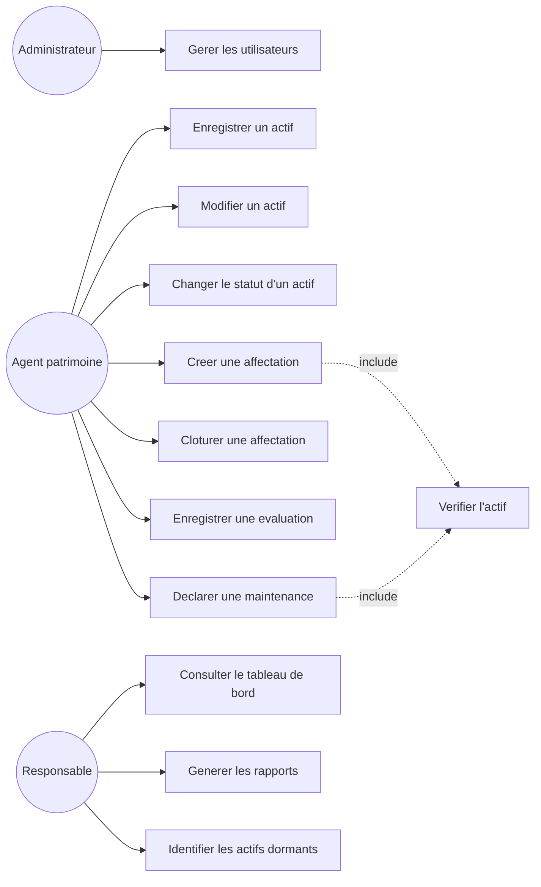
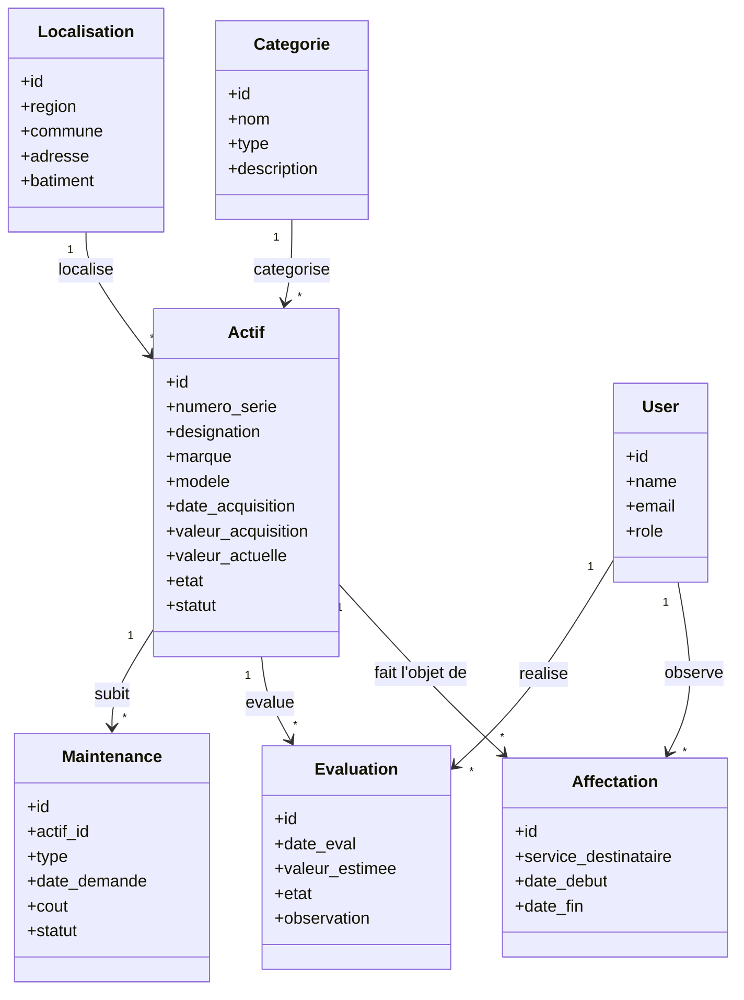

# Analyse du besoin — Gestion du Patrimoine de l'État (GPE)

## 1. Contexte

L'État béninois gère un patrimoine immobilier, mobilier et roulant dispersé sur
l'ensemble du territoire. Aujourd'hui, l'inventaire est tenu de façon
manuelle (registres papier, tableurs), ce qui entraîne :

- Perte de traçabilité des biens (vols, détournements non détectés)
- Impossibilité de connaître la valeur réelle du patrimoine
- Difficulté à suivre les maintenances et leurs coûts
- Aucune vision consolidée pour la direction

## 2. Objectifs

- Centraliser l'inventaire de tous les biens de l'État
- Suivre le cycle de vie de chaque actif (acquisition → service → réforme → sortie)
- Gérer les affectations aux services et les évaluations périodiques
- Fournir des rapports et tableaux de bord à la direction
- Garantir la traçabilité (audit) des opérations

## 3. Acteurs et cas d'utilisation

| Acteur | Rôle |
|---|---|
| Administrateur | Gestion des comptes et des rôles |
| Agent du patrimoine | Saisie et mise à jour des fiches actifs, affectations, évaluations |
| Responsable | Consultation des rapports, validation des sorties de patrimoine |
| Système | Notifications, calculs de valeur, journalisation |

### Diagramme de cas d'utilisation (UML)



## 4. Règles métier

- **RB1** — Un actif ne peut avoir qu'**une seule affectation en cours** (`date_fin` NULL).
- **RB2** — Un actif ne peut être supprimé s'il a une affectation en cours.
- **RB3** — Le changement de statut suit le cycle : `en_service → maintenance → (en_service | reforme | cession) → sorti`.
- **RB4** — Chaque évaluation peut mettre à jour `valeur_actuelle` et `etat` de l'actif.
- **RB5** — Une maintenance `clos` ne peut plus être modifiée ni supprimée.
- **RB6** — Seul l'administrateur crée des comptes (le premier compte créé devient admin).
- **RB7** — Un "actif dormant" = `en_service` + aucune affectation en cours + aucune évaluation depuis 12 mois.
- **RB8** — Toute création/modification est attribuée à l'utilisateur connecté (`observe_par`, `eval_par`, `demande_par`).

## 5. Diagramme de classes (UML)



> Note : `Maintenance` et `User` vivent dans des services distincts ; les liens
> sont des **références logiques** (IDs), pas des clés étrangères.

## 6. Diagramme de déploiement (architecture micro-services)

```mermaid
graph TB
    Client((Navigateur))
    subgraph Docker["Docker Compose"]
        GW[Nginx Gateway :8080]
        AUTH[auth-service :8000<br/>Laravel + Sanctum]
        AST[asset-service :8000<br/>Laravel]
        MAINT[maintenance-service :8000<br/>Laravel]
        DB[(PostgreSQL :5432<br/>gpe_auth / gpe_assets / gpe_maintenance)]
    end
    Client -->|HTTP| GW
    GW --> AUTH
    GW --> AST
    GW --> MAINT
    AUTH --> DB
    AST --> DB
    MAINT --> DB
    AST -.->|GET /api/me| AUTH
    MAINT -.->|GET /api/me + /api/actifs/{id}| AUTH & AST
```
